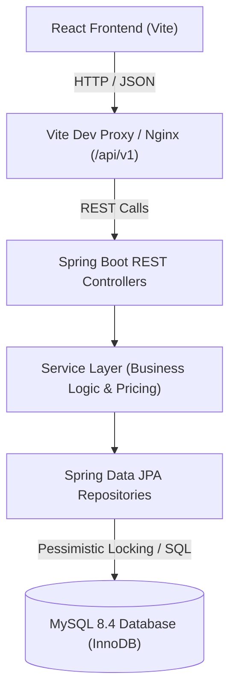
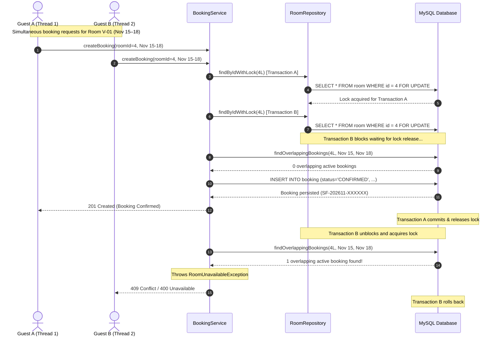
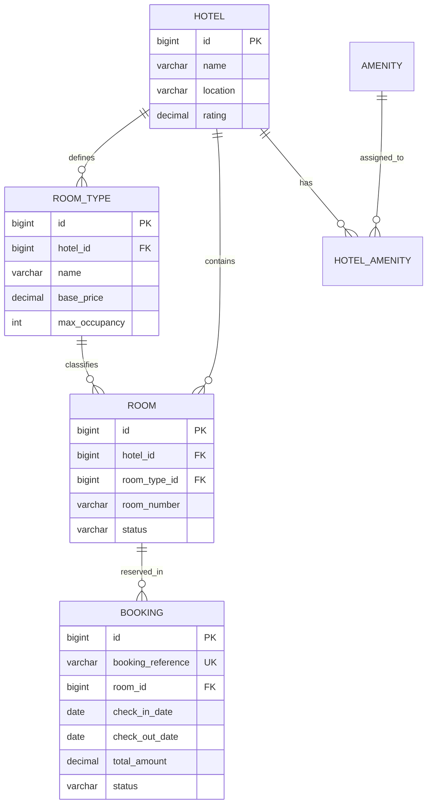

# StayFinder – Architectural Hotel Reservation Platform

[](https://www.oracle.com/java/)
[](https://spring.io/projects/spring-boot)
[](https://react.dev/)
[](https://www.mysql.com/)
[](https://flywaydb.org/)
[](https://vitejs.dev/)

StayFinder is an editorial travel and sanctuary reservation platform built with **Spring Boot 3.4**, **MySQL 8.4**, and **React 18**. It is engineered to solve a common defect in commercial booking systems: **phantom availability and double-booking collisions under high concurrent load**, by enforcing physical room inventory allocation via row-level pessimistic write locking.

---

## 📌 Problem Statement & Core Concept

Many hospitality booking platforms allocate inventory abstractly by room category counts rather than specific physical inventory. When high traffic spikes occur (such as promotional drops or flash bookings), race conditions often result in:
1. Two guests simultaneously reserving the same physical room for overlapping dates.
2. Inconsistent pricing calculations between client and server.
3. Inventory desynchronization when bookings are cancelled or modified.

**StayFinder addresses this through:**
- **Exact Physical Room Allocation:** Reservations map directly to a verified physical suite (e.g., Suite `101`, Villa `V-01`).
- **Pessimistic Write Locking (`SELECT ... FOR UPDATE`):** Simultaneous booking attempts for the same physical room block until the active transaction completes, guaranteeing that only one reservation succeeds.
- **Half-Open Date Interval Semantics:** Check-in date is inclusive and check-out date is exclusive (`[checkIn, checkOut)`), allowing back-to-back stays without artificial date gap buffers.
- **Server-Authoritative Pricing:** Client-provided prices are never trusted; rates are calculated on the server using `BigDecimal` arithmetic based on verified room type rates and night counts.

---

## 🌟 Key Features

### Frontend (Editorial Luxury Experience)
- **Distinctive Visual Aesthetic:** Styled with warm ivory canvas, deep forest green, warm brass accents, and muted terracotta typography (*Cormorant Garamond* serif headings & *Plus Jakarta Sans* body).
- **Interactive Stay Calendar:** Real-time date range picker with live price calculations and dynamic night duration counting.
- **Physical Room Selection:** Choose specific suites by room number, floor level, base rate, and maximum guest occupancy.
- **Reservation Voucher:** Instant booking confirmation with reference badge (`SF-YYYYMM-XXXXXX`) and integrated print voucher formatting (`window.print()`).
- **Self-Service Reservation Management:** Look up reservations by unique reference code or search full booking history by guest email, with one-click transactional cancellation.
- **Zero-State & Error Resilience:** Defensive rendering, user-friendly error banners, empty search fallback recommendations, and responsive mobile-first navigation.

### Backend & Core Engine
- **RESTful API Architecture:** 12 documented endpoints adhering to REST conventions with OpenAPI 3.0 / Swagger UI documentation.
- **Concurrency Protection Engine:** Row-level pessimistic locking via Spring Data JPA and MySQL InnoDB.
- **Database Migrations:** Automated schema versioning and deterministic seed data managed via Flyway.
- **Defensive Input Validation:** Jakarta Bean Validation enforcing future date checks, valid email formats, and string lengths.
- **Global Error Handling:** Unified JSON error payloads with RFC 7807 compliance, field validation breakdown, and appropriate HTTP status codes (400, 404, 409, 500).

---

## 🏗️ Architecture & Concurrency Workflow

### System Architecture



### Double-Booking Prevention Sequence



---

## 🗄️ Database Schema Overview

The database schema is managed via Flyway (`V1__create_database_tables.sql` and `V2__insert_sample_hotels.sql`):



---

## 🔌 API Endpoint Summary

| Method | Endpoint | Description |
| :--- | :--- | :--- |
| `GET` | `/api/v1/health` | Service health status |
| `GET` | `/api/v1/hotels` | Paginated hotel listings (`?page=0&size=10&sort=name,asc`) |
| `GET` | `/api/v1/hotels/{id}` | Detailed hotel profile with amenities and room types |
| `GET` | `/api/v1/hotels/search` | Search hotels by location query (`?location=Goa`) |
| `GET` | `/api/v1/hotels/{hotelId}/availability` | Check room availability for stay dates (`?checkIn=&checkOut=&guests=`) |
| `GET` | `/api/v1/hotels/room-types/{id}/availability`| Check availability for a specific room type |
| `POST`| `/api/v1/bookings` | Create reservation with concurrency locking |
| `GET` | `/api/v1/bookings/{reference}` | Retrieve booking by reference code |
| `GET` | `/api/v1/bookings` | Retrieve bookings by guest email (`?email=guest@example.com`) |
| `PATCH`| `/api/v1/bookings/{reference}/cancel` | Cancel booking and release room back to inventory |
| `POST`| `/api/v1/bookings/calculate-price` | Server-authoritative price calculation |

---

## 💻 Setup & Installation Guide

### Prerequisites
- **Java Development Kit (JDK):** Version 21 LTS
- **Node.js & npm:** Node 18+ and npm 9+
- **MySQL Server:** Version 8.4 LTS running on port 3306

---

### Step 1: Clone Repository & Configure Environment

```bash
git clone https://github.com/your-username/stayfinder-hotel-booking.git
cd stayfinder-hotel-booking
```

Copy the environment templates:
```bash
cp .env.example .env
cp frontend/.env.example frontend/.env
```

Edit `.env` with your local MySQL credentials:
```properties
DB_HOST=localhost
DB_PORT=3306
DB_NAME=stayfinder_db
DB_USERNAME=stayfinder_app
DB_PASSWORD=your_secure_password
DB_MIGRATION_USERNAME=stayfinder_migration
DB_MIGRATION_PASSWORD=your_migration_password
SERVER_PORT=8080
CORS_ALLOWED_ORIGINS=http://localhost:5173,http://localhost:3000
```

> **Note:** The Spring Boot backend includes a custom `DotenvEnvironmentPostProcessor` that automatically loads root `.env` variables into the Spring Environment upon startup.

---

### Step 2: Database Initialization

Create the MySQL database:
```sql
CREATE DATABASE IF NOT EXISTS stayfinder_db CHARACTER SET utf8mb4 COLLATE utf8mb4_unicode_ci;
```

Flyway will automatically execute migrations `V1` and `V2` on application startup to create tables and insert sample hotel sanctuaries across Goa, Jaipur, Mumbai, Manali, and Alleppey.

---

### Step 3: Start Backend Service

```bash
cd backend

# On macOS / Linux:
./mvnw spring-boot:run

# On Windows PowerShell:
.\mvnw.cmd spring-boot:run
```

- Backend API: `http://localhost:8080/api/v1`
- Swagger UI Documentation: `http://localhost:8080/swagger-ui/index.html`

---

### Step 4: Start Frontend Development Server

In a new terminal window:
```bash
cd frontend
npm install
npm run dev
```

Open your browser at `http://localhost:5173`.

---

## 🧪 Testing & Verification

The application includes unit tests, MockMvc controller slice tests, and database integration tests.

### Running Backend Tests
```bash
cd backend

# Run the complete test suite (46 tests)
.\mvnw.cmd test

# Run focused MySQL concurrency integration test
.\mvnw.cmd "-Dtest=BookingConcurrencyIntegrationTest" test
```

### Running Frontend Production Build
```bash
cd frontend
npm run build
```

---

## 📸 Screenshots

*(Place screenshots of the application in this section when available)*

| Hotel Discovery & Search | Interactive Stay Calendar |
| :---: | :---: |
|  |  |

| Reservation Voucher | Manage Reservations |
| :---: | :---: |
|  |  |

---

## ⚠️ Known Limitations & Future Improvements

While StayFinder provides database-level concurrency protection and input validation, the following production features are intentionally omitted or simplified in this release:

1. **Payment Gateway Integration:** No third-party payment gateway (e.g., Stripe, Razorpay) is integrated; bookings transition directly to `CONFIRMED` upon inventory lock.
2. **User Authentication & Authorization:** Guests book using their name and email without an account/password system or JWT authentication.
3. **Email Notification Service:** Booking vouchers are rendered in-browser and printable via `window.print()`; background transactional email delivery (SMTP/SES) is not implemented.
4. **Distributed Cache:** Room availability is queried directly from MySQL via indexed queries. For high-throughput enterprise scale, a Redis distributed caching layer with TTL eviction would reduce database load.
5. **Distributed Locking for Multi-Database Sharding:** Row-level locks (`SELECT ... FOR UPDATE`) are bound to a single relational database instance. Multi-region database sharding would require distributed locking (e.g., Redlock or ZooKeeper).

---

## 📄 License

This project is licensed under the MIT License. See the [LICENSE](LICENSE) file for details.
